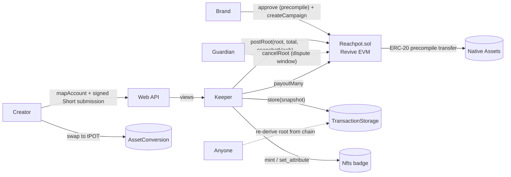

# Reachpot

**Get paid for your reach, fairly.** Pro-rata creator campaigns on [Portaldot](https://portaldot.io) V3, funded in any
Portaldot native asset.

A brand locks a pot on-chain in tPOT or any native `Assets` token, including its own. Creators post YouTube Shorts.
When the window closes, the pot is split **by views**, with a per-creator cap, and paid to every creator's Portaldot
account. Creators cash out on Portaldot's native DEX, and every payout levels up a soulbound creator badge.

> **Status:** deployed on **Portaldot V3 testnet**: `Reachpot` at
> [`0xcfcdb8ccac9b95534aedbbe9c90e49a6a1d493cf`](deployments/testnet.json) (deploy tx
> `0x437ca8659ea19af2ba7cc578e755eed2f3d1aaca4a7d1a65dada5412c6273a15`, block 150,033), with the rUSD/NOVA native
> assets, native-DEX pools and the badge collection. The full lifecycle runs end to end on a local chain with Portaldot's
> runtime ([e2e run](docs/e2e-local.md)); the scripted testnet run is next ([runbook](docs/testnet.md)).
> Built for [Portaldot Hacker House 2026](https://dorahacks.io/hackathon/portaldot-hacker-house-2026/detail), Ecosystem DApps track.

## Why

Brands pay "clippers" per view, but fixed-CPM budgets have three problems:

1. **The budget drains first-come.** Late creators with great posts earn nothing.
2. **Payouts are opaque.** The platform decides what counts and pays off-chain.
3. **Rejection pays.** Rejecting a submission saves the brand money, so creators carry the risk.

A **pro-rata pool escrowed on-chain** fixes all three. The budget is always fully and fairly spent, the brand cannot
claw it back, and rejecting a creator saves the brand nothing because their share goes to the other creators.
Portaldot projects get a growth tool on top: they can pay creators **in their own token**, and creators can cash out
straight away.

## Why Portaldot

Reachpot is built from Portaldot V3's native modules and its EVM working together. On a plain EVM chain you would
have to deploy and trust a separate DEX, NFT contract and data-availability layer for this.

| Portaldot V3 feature | How Reachpot uses it |
|---|---|
| **Revive (EVM) + native-asset ERC-20 precompiles** | `Reachpot.sol` escrows native `Assets` tokens directly through their precompile (`0x{assetId}000000000000000000000000` + `00010000`). Any project token works, with no wrapping and no bridge. |
| **H160 ↔ native account mapping** | Brands fund from MetaMask (EVM). Creators use a Portaldot wallet; after `revive.mapAccount`, payouts sent to their H160 land in their native account. |
| **AssetConversion (native DEX)** | Creators swap payouts to tPOT in one tap, using live on-chain quotes. Campaigns add volume to the token's pool. |
| **TransactionStorage** | The keeper publishes the allocation snapshot on-chain. The contract pins its blake2-256 hash and location, so anyone can re-derive the payout root. |
| **Nfts** | Every payout mints or updates a **soulbound** creator badge whose attributes (campaigns, views, earned) are a portable on-chain résumé. |

## How it works



1. **Fund.** The brand approves its token through the native-asset precompile and calls `createCampaign`. The pool is
   escrowed, and the campaign's rules (brief, min views) are hash-pinned on-chain as `rulesHash`.
2. **Submit.** Creators connect a Portaldot wallet, enable payouts once (`revive.mapAccount`), and submit Shorts. Each
   submission is signed by the creator's wallet, binding the video to the payout account.
3. **Snapshot.** After the window plus a measurement delay, the keeper computes the capped pro-rata ("water-filling")
   split, stores the snapshot in `TransactionStorage`, and posts the Merkle root together with the snapshot's hash and location.
4. **Dispute.** During the dispute window a guardian can cancel a bad root. Anyone can recompute it from chain data:
   the campaign page does this in the browser, and `pnpm verify` does it on the CLI.
5. **Pay.** The keeper pushes every payout with `payoutMany`. Recipients without a native balance get the existential
   deposit sponsored, and a failing recipient is skipped and retried rather than blocking the batch. Badges are minted or updated.
6. **Refund.** The brand can reclaim only what was never allocated, or everything if no root is ever posted.

## Run it locally (full lifecycle in ~5 minutes)

Requirements: Node 22+, pnpm 8+, [Foundry](https://getfoundry.sh). macOS arm64 or Linux x86_64 for the local chain.

```bash
git clone --recursive https://github.com/lazydevpro/reachpot && cd reachpot
pnpm install
pnpm test            # 23 Foundry tests (incl. fuzz + golden fixtures) + 17 allocation tests
pnpm chain:up        # local chain with Portaldot's runtime: Parity substrate-node (kitchensink) + eth-rpc, sha256-verified
pnpm deploy:local    # Reachpot + rUSD/NOVA native assets + DEX pools + badge collection → deployments/local.json
pnpm dev             # web app + keeper on http://localhost:3000
pnpm e2e             # (another terminal) brand → creators → snapshot → payouts → verify → DEX cash-out → docs/e2e-local.md
```

On the local chain the app offers **pre-funded dev wallets**, so no browser extension is needed: "Dorothy" for brands,
"Demo creator accounts" for creators. Views are simulated locally; each Short has a "+25K views (demo)" button.
`pnpm chain:down` stops the chain.

## Deploy

The web app runs on **Vercel**, with **Neon Postgres** for data and **GitHub Actions** ticking the keeper about once a
minute. CI runs the contract, allocation, typecheck and build checks on every push. Step by step:
**[docs/deploy.md](docs/deploy.md)**.

## Testnet

Portaldot V3 testnet: `wss://test-node-v3.portaldot.dev` · EVM `https://test-evm-rpc-v3.portaldot.dev` (chain id
`420420777`) · explorer https://node-console.portaldot.dev. See **[docs/testnet.md](docs/testnet.md)** for the deploy
runbook, the tPOT budget and the check-in checklist.

## Repository

```
contracts/            Foundry: Reachpot.sol + tests (unit, fuzz, golden fixtures shared with TS)
packages/allocation/  Water-filling split, Merkle tree, snapshot format, `reachpot-verify` CLI
packages/core/        Networks, generated ABI, precompile + native (Substrate) helpers
scripts/              Local chain, deploy, e2e, accounts, precompile spike
apps/web/             Next.js 16 app + API + keeper (PGlite/drizzle), krafa-style UI
docs/                 Spec, plan, testnet runbook, spike + e2e evidence
```

## Trust model and limitations

| Component | Trust |
|---|---|
| Pool custody, payout limits, refunds | **Trustless.** Enforced by `Reachpot.sol` (`claimed ≤ totalAllocated ≤ pool`; the brand can't withdraw a live pool; full refund if no root before the timeout). |
| Allocation math | **Verifiable.** The snapshot is on-chain and hash-pinned, and the split and root are recomputable by anyone. |
| Which Shorts count, and view counts | **Oracle (v1).** Mitigated by the published snapshot, open-source allocation, the dispute window and the guardian. |

Known limitations:
- On Portaldot, deploying costs a storage deposit of **~0.078 tPOT per byte of initcode** (0.06/byte code deposit + 30%
  code-hash lockup), so the contract is deliberately small (5.9 KB initcode, 448 tPOT on testnet): no owner/admin surface
  (oracle and guardian fixed at deploy), standard tokens only (no fee-on-transfer; native assets qualify).
- Enabling payouts reserves a refundable `revive.mapAccount` deposit of 52 bytes plus 1 item, which is **about 3.3 tPOT on testnet**.
- `TransactionStorage` retention depends on the node: archive nodes may keep block bodies, and YouTube's data-policy
  limits apply to stored statistics. That's why the snapshot carries only per-creator totals and allocations.
- Real YouTube verification uses a binding code in the Short's description and the Data API (`YOUTUBE_API_KEY`).

## Prior work and attribution

- The pro-rata creator-pool concept comes from the author's earlier project **ClipPool** (USDC campaigns on Arc,
  Oct 2026). Reachpot is a new Portaldot-native implementation; all code here was written during Portaldot Hacker House 2026.
- Third-party code and tools: [OpenZeppelin Contracts](https://github.com/OpenZeppelin/openzeppelin-contracts) v5.1.0
  and [merkle-tree](https://github.com/OpenZeppelin/merkle-tree), [forge-std](https://github.com/foundry-rs/forge-std),
  [viem](https://viem.sh), [@polkadot/api](https://github.com/polkadot-js/api), [Next.js](https://nextjs.org),
  [drizzle](https://orm.drizzle.team) + [PGlite](https://pglite.dev), [motion](https://motion.dev), [lucide](https://lucide.dev),
  [Open Runde](https://github.com/lauridskern/open-runde) (OFL). The local chain uses Parity's official
  [polkadot-sdk](https://github.com/paritytech/polkadot-sdk) release binaries. Landing-page design inspired by [krafa.ai](https://krafa.ai).

## License

[MIT](LICENSE)
