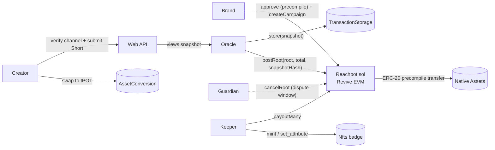

# Reachpot

**Get paid for your reach, fairly.** Reachpot runs pro-rata creator campaigns on [Portaldot](https://portaldot.io) V3,
funded in any Portaldot native asset.

A brand locks a pool on-chain in tPOT or any native `Assets` token, including its own. Creators post YouTube Shorts
for the campaign. When the window closes the pool is split **by views**, with a per-creator cap, and paid to every
creator on-chain. Creators can then cash out to tPOT on Portaldot's native DEX.

> Status: 🚧 in active development for [Portaldot Hacker House 2026](https://dorahacks.io/hackathon/portaldot-hacker-house-2026/detail)
> (Ecosystem DApps track). See [TODO.md](TODO.md) for progress and [docs/plans/spec.md](docs/plans/spec.md) for the spec.

## Why

Brands pay "clippers" per view, but fixed-CPM budgets have three problems:

1. **The budget drains first-come.** Late creators with great posts earn nothing.
2. **Payouts are opaque.** The platform decides what counts and pays off-chain.
3. **Rejection pays.** Rejecting a submission saves the brand money, so creators carry the risk.

A **pro-rata pool escrowed on-chain** fixes all three. The budget is always fully and fairly spent, the brand cannot
claw it back, and rejecting a creator saves the brand nothing because their share goes to the other creators.

## Why Portaldot

| Portaldot V3 feature | How Reachpot uses it |
|---|---|
| `Revive` EVM + native-asset ERC-20 precompiles | The Solidity escrow holds native `Assets` tokens directly through their precompile (`0x{assetId}000000000000000000000000` + `00010000`). Any project token works, with no wrapping and no bridge. |
| `AssetConversion` native DEX | Creators paid in a project token swap to tPOT in one action, which also adds volume to that token's pool. |
| `TransactionStorage` | The allocation snapshot is published on-chain. Standard nodes keep it for its retention period (about 7 days on testnet), which is long enough for anyone to verify the payout root during the dispute window. The contract keeps only the snapshot's hash and location. |
| `Nfts` | Creators earn a non-transferable creator badge whose attributes form a portable on-chain résumé. |

## How it works



1. **Create.** The brand approves the token through its precompile and calls `createCampaign`, which escrows the pool.
2. **Submit.** Creators prove channel ownership and submit Shorts during the window.
3. **Snapshot.** After the measurement delay, the oracle stores the view snapshot in `TransactionStorage`, computes the
   pro-rata split and posts the Merkle root together with the snapshot's hash and location.
4. **Dispute.** A guardian can cancel a bad root within the dispute window. Anyone can recompute the root from the
   on-chain snapshot.
5. **Payout.** A keeper pushes every payout with `payoutMany`. A recipient whose transfer fails is skipped and stays
   payable. The brand can reclaim only the unallocated remainder, or everything if no root is ever posted.

## Repository

```
contracts/      Foundry: Reachpot.sol + tests (unit, fuzz)
scripts/        Testnet scripts (viem for EVM, @polkadot/api for native pallets)
docs/plans/     spec and plan
```

## Quickstart

Requirements: Node 22+, pnpm 8+, [Foundry](https://getfoundry.sh).

```bash
git clone --recursive https://github.com/lazydevpro/reachpot && cd reachpot
pnpm install
pnpm test:contracts
```

Testnet scripts read `.env`, which holds throwaway testnet keys and is never committed:

```bash
pnpm --filter @reachpot/scripts accounts   # show accounts + tPOT balances
pnpm spike                                  # precompile write-path spike → docs/spike-precompile.md
```

## Network

| | |
|---|---|
| Substrate RPC | `wss://test-node-v3.portaldot.dev` |
| EVM RPC | `https://test-evm-rpc-v3.portaldot.dev` (chain id `420420777`) |
| Explorer | https://node-console.portaldot.dev |

## Prior work and attribution

- The pro-rata creator-pool concept comes from the author's earlier project **ClipPool** (USDC campaigns on Arc,
  Oct 2026). Reachpot is a new Portaldot-native implementation; all code in this repository was written during
  Portaldot Hacker House 2026.
- Third-party code: [OpenZeppelin Contracts](https://github.com/OpenZeppelin/openzeppelin-contracts) v5.1.0,
  [forge-std](https://github.com/foundry-rs/forge-std), [viem](https://viem.sh),
  [@polkadot/api](https://github.com/polkadot-js/api).

## License

[MIT](LICENSE)
