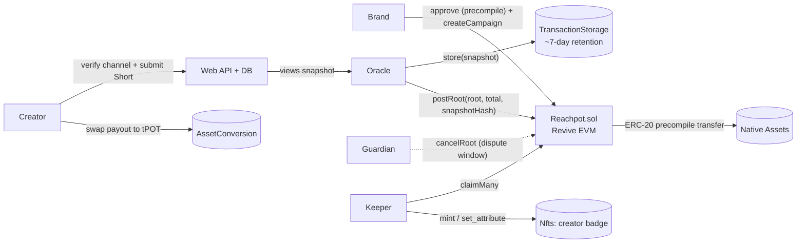

# Reachpot — plan

See [spec.md](spec.md) for the what and why.

## Architecture



## Repository layout

```
contracts/            Foundry: Reachpot.sol, tests (unit, fuzz, invariant, golden fixtures)
packages/allocation/  TS: water-filling pro-rata split, Merkle tree, `verify` CLI
packages/portaldot/   TS: chain config, precompile address helper, native-side helpers (@polkadot/api)
scripts/              Testnet scripts: fund, create asset, deploy, end-to-end run
apps/web/             Next.js app + API routes (campaigns, submissions, oracle/keeper jobs)
docs/                 plans/, deployments.md, architecture
```

Tooling: pnpm workspaces · Foundry (compile/test, standard EVM bytecode since `AllowEVMBytecode = true`) · viem for EVM-side
scripts · @polkadot/api for native-side scripts. Forge is not used for deploying: Foundry against Revive is
undocumented, and viem scripts give us a single path for both sides.

## Phases

Each phase ends with a verifiable artifact.

### Phase 0: de-risk spike (today)
- `PrecompileProbe.sol` plus a script. The native admin creates a test asset ("rUSD") and mints it to the EVM brand
  account; the brand calls `approve` on the precompile; the probe calls `transferFrom`, then `transfer`s to a fresh
  H160 with no native balance.
- **Done when:** we know which of these work, with tx hashes, and we've chosen how to handle risk #2 (recipients with
  no native balance).

### Phase 1: core contract (today → tomorrow)
- `Reachpot.sol`: `createCampaign`, `postRoot`, `cancelRoot`, `claimMany`, `refund`; events; custom errors.
- Foundry tests for AC2–AC5, including fuzz and invariant tests.
- **Done when:** `forge test` is green.

### Phase 2: allocation + snapshot (tomorrow)
- `packages/allocation`: water-filling with cap and minViews, bigint math, sorted leaves, OZ-compatible Merkle tree,
  golden fixtures consumed by the Foundry tests.
- `TransactionStorage.store(snapshot)`; record `(block, index, blake2_256)`; `verify` CLI.
- **Done when:** AC6 and AC7 pass.

### Phase 3: testnet end-to-end + check-in (by Oct 24 12:00 UTC)
- `scripts/e2e.ts`: asset → fund → campaign → snapshot → root → dispute window → claimMany → refund. Writes
  `docs/deployments.md`.
- Minimal web: campaign page, leaderboard, receipts (reads chain + snapshot).
- README: pitch, architecture diagram, deployments, quickstart, prior-work disclosure.
- **Done when:** the check-in is submitted on DoraHacks.

### Phase 4: product (Oct 25 → Nov 4)
- YouTube OAuth channel verification, submissions, view refresh, oracle/keeper cron.
- Creator badge NFTs (AC8), DEX cash-out (AC9), full web flows (AC10).
- Stretch: MetaTx sponsorship, fee payment in assets.

### Phase 5: ship (Nov 4 → Nov 6 04:00 UTC)
- Hosted demo, video of 3 minutes or less, pitch deck PDF, final README and deploy docs. Code freeze.
